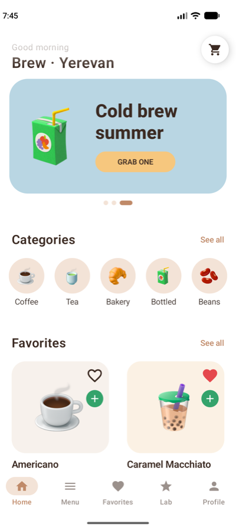
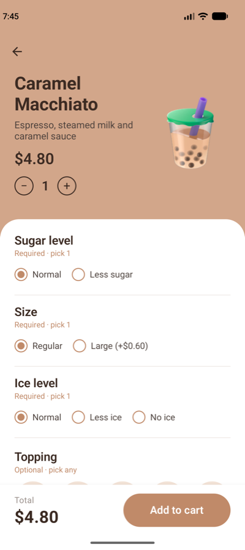
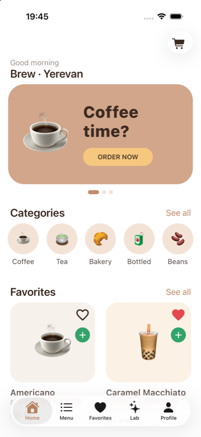

# Brew — Remote Compose demo (DevFest Armenia 2026)

A coffee-shop app whose **native shell** (tabs, navigation, cart, snackbars) is ordinary app code, and whose
**content sections** — banners, categories, product cards, the product page — are
[Remote Compose](https://developer.android.com/jetpack/androidx/releases/compose-remote) documents sent by a server.
The same bytes play on **Android** (the androidx player) and **iOS** (the community player
[rc-players](https://github.com/yschimke/rc-players)). Change the server, pull to refresh: new UI, no app release.

| Android | Product page | iOS, same bytes |
|---|---|---|
|  |  |  |

Built for the talk *UI Without a Release* (DevFest Armenia 2026). Remote Compose **1.0.0-alpha24**.

## Run it — no server needed

Both apps work on their own: Android builds the sections on the device, iOS plays copies bundled in the app.

| | You need | Do this |
|---|---|---|
| **iOS** | a Mac (Apple Silicon) with Xcode — built with Xcode 27.2 | open `ios/Brew.xcodeproj` → pick an iPhone simulator → **Run** |
| **Android** | Android Studio with the Android 37 SDK — or the SDK alone, from the command line | open the `android/` folder → **Run** the `app` configuration |

Details and troubleshooting: [ios/README.md](ios/README.md), [android/README.md](android/README.md).

## Add the server — live UI from the backend

```bash
cd backend
go run ./cmd/demo serve
```

A small Go server. You need [Go](https://go.dev/dl) 1.21+ (it runs the release `backend/go.mod` pins by itself) and a
JDK 17+ (Android Studio bundles one; it is found by itself). The first start builds the JSON converter (about a
minute). When you see `Brew backend listening`, pull to refresh on the app's Home — every pull shows a new random
choice of banners. Edit the promo in [`backend/stage.json`](backend/stage.json) and pull again; after changing
banners, favourites or the Kotlin sections, run `go run ./cmd/demo render` first. More:
[backend/README.md](backend/README.md).

The commands are Go programs, not shell scripts: the same on macOS, Linux and Windows. Checked on macOS and on Linux
(rendering on Linux gives byte for byte the same documents); on Windows the Go and Gradle parts are built for it
(`gradlew.bat`, `rc.bat`) but have not been run there yet.

If the apps can't reach the server they keep working offline and say so in the log
(Android: Logcat, tag `Brew`; iOS: Xcode's console) with the exact steps to fix it.
A phone on Wi-Fi instead of an emulator or simulator: `go run ./cmd/demo serve -lan` — see the app READMEs.

## What is where

```
shared/    the Remote Compose UI itself (Kotlin @RemoteComposable), used by tools/ and by the Android app offline
tools/     rc: renders the sections into documents on a plain JVM, converts JSON documents (Kotlin)
backend/   the server (Go): serves the rendered documents, picks the banners, builds the JSON promo
android/   Brew for Android (Jetpack Compose + the androidx Remote Compose player)
ios/       Brew for iOS (SwiftUI + rc-players)
gradle/    one version catalog for the Gradle builds (shared, tools, android)
ci/        static analysis: what .github/workflows/ci.yml runs, and ci/check.py to run it locally
config/    detekt's config (detekt.yml); the Android Lint checks off in app and shared (lint-volatile-checks.txt)
```

## How it works

```
 backend ──bytes──▶ document (Remote Compose)  ──asks: hostAction("add_to_cart:mocha") ──▶ app (native)
                     draws, animates, keeps its own      ◀── pushes: named values ("fav_mocha" = red) ──
                     state (quantity, options)                 decides: cart, navigation, favourites
```

- **The document draws and asks; the app decides.** A tap in a section sends a named *host action*; the app's code
  (cart, navigation, favourites) handles it and pushes the result back as *named values*. Quantity and options
  live inside the product-page document; it reports the choice, and the app prices it from its own catalog.
- **Documents are made two ways, like in a real pipeline:**
  1. **Kotlin → binary, at build time.** Sections are `@RemoteComposable` Kotlin functions (`shared/…/brew/remote`).
     `go run ./cmd/demo render` renders them into `.rc` files on a plain JVM — no Android, no emulator — and the Go server
     serves the files. Lists are the apps' own, made of one row document per product, so every document is fixed.
  2. **JSON → binary, per request.** The *Happy hour* card starts as a JSON document
     ([`backend/promo.json`](backend/promo.json)); the Go server edits it as data — fills the texts, builds one row per
     drink — and converts it with `rc json2rc` (cached). See it: `curl http://127.0.0.1:8080/sections/promo.json`.
- **The server decides what the app shows:** which banners, in which order — a new random choice on every pull to
  refresh (`/sections/banners`).
- **The Lab tab** shows GPU shaders (AGSL) delivered as documents: liquid latte, a coffee ripple you tap, a
  lenticular flip card you drag, holographic foil, a lava lamp, an aurora, hyperspace. Android only builds them
  (shaders have no public authoring API yet); iOS plays copies bundled in the app.

## Good to know

- **Alpha.** Remote Compose is 1.0.0-alpha24; APIs change every two weeks.
- **Public vs internal API.** The sections (`brew.remote`) use only the public API, enforced by lint
  (`RestrictedApi` is an error in `shared/`). Some things have no public API yet and use `@RestrictTo` code on
  purpose: the players inside the apps, the JVM capture and the JSON converter in `tools/`, and the shader documents
  of the Lab. Why and how the sections run without Android: [tools/README.md](tools/README.md).
- **Player limits** (from `Limits.java`): one string in a document ≤ 4 000 bytes (a shader's source too), images
  ≤ 8 000 px and 20 MB per player, ≤ 32 MB unpacked, ≤ 20 000 operations per frame.
- **Shaders:** the androidx player runs none unless the app allows them; the Android Lab allows exactly its own
  shader sources (an allow-list). rc-players (iOS) runs shaders without asking.
- **Documents are untrusted input**, and the apps treat them so: the price the app charges is worked out from its
  own catalog (the document only reports the options), unknown ids are ignored, reported numbers are checked and
  clamped, and Android validates every document's structure before playing it (`DocumentValidator`; iOS only
  checks the header). In production also: your server only, over HTTPS.

## Check everything

What CI runs (Linux; [ci/README.md](ci/README.md) has the details and the tool versions):

```bash
cd backend && go run ./cmd/demo lint -check && go tool govulncheck ./...   # fmt --diff, golangci-lint, vet, tests -race; vulnerabilities
cd tools && ./gradlew --continue test ktfmtCheck detekt   # rendering, the committed documents are current, JSON → .rc; style; detekt
cd android && ./gradlew --continue :app:ktfmtCheck :shared:ktfmtCheck :app:lintDebug :shared:lintDebug :app:detekt :shared:detekt
python3 ci/check.py gitleaks osv swiftlint swift-format   # with the tools on the PATH; swift-format: macOS only, not in CI
```

CI builds the rc tool first (`cd tools && ./gradlew installDist`), so the backend's end-to-end test runs there. CI does
not compile the iOS app or run swift-format (they need macOS and Xcode). Before pushing Swift changes, also run:

```bash
cd ios && xcodebuild -scheme Brew -destination 'generic/platform=iOS Simulator' build   # strict concurrency, warnings are errors
```

Day to day, `cd backend && go run ./cmd/demo lint` formats the Go code in place and runs the same Go checks.

## License

[Apache 2.0](LICENSE).
